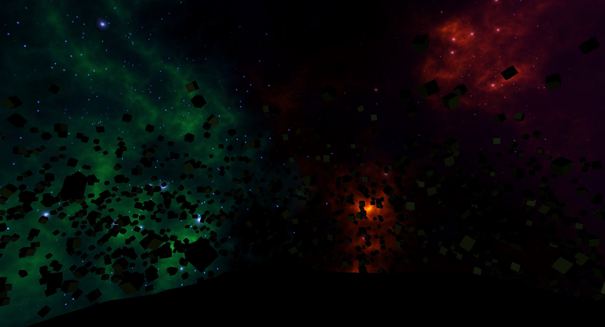
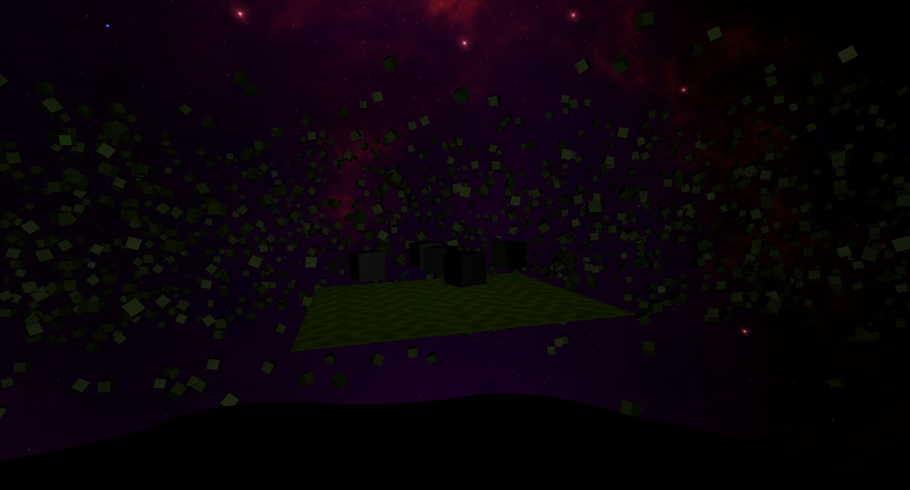

# EmptySpace - Yet Another Space Game




Space flight Demo with OpenGL based deferred rendering.

## Project layout

| Directory    | Target                | Contents                                                        |
|--------------|-----------------------|-----------------------------------------------------------------|
| `EmptySpace/`| `EmptySpace.lib`      | The static library. All rendering, scene and physics logic.     |
| `App/`       | `App.exe`             | The application. Window, input and the frame loop only.         |
| `Test/`      | `Test.exe`            | Catch2 unit tests for the library.                              |

The library is compiled once; the application and the tests link against it.
Each directory is a self-contained CMake project and can be configured on its
own, the root `CMakeLists.txt` is only an umbrella that includes all three.

```
EmptySpace/
  include/       public headers
  source/        implementation
App/
  source/        main.cpp
Test/
  source/        unit tests
```

## Controls

```
 - W = accelerate forward
 - S = accelerate backward
 - A = accelerate to the left
 - D = accelerate to the right
 - Space = accelerate up
 - LCtrl = accelerate down
 - LShift = boost by factor 10
 - Q = roll left
 - E = roll right
 - R = stop acceleration
 - Mouse = tumble
```

## Requirements

Development is done with
* Conan 2.x
* CMake 3.25.x or newer
* Visual Studio 2022 or newer

External dependencies
* GLFW
* GLAD
* PhysX
* stb_image
* glm
* assimp
* Catch2

## Building

Note the conan install step can take a long time due to the size of PhysX

### Linux

Conan install for debug or release build type
```
conan install . --build=missing --settings=build_type=Debug
```

or release build type
```
conan install . --build=missing --settings=build_type=Release
```

CMake project generation for debug
```
cmake --preset conan-debug
```

or relase build
```
cmake --preset conan-release
```

Build files for debug build config should be located at
```
build/Debug
```

and for release config at
```
build/Release
```

Build the project in debug config with
```
cmake --build build/Debug
```

or in release config with
```
cmake --build build/Release
```

### Windows

Conan install for debug and release build types for multi generator
```
conan install . --build=missing --settings=build_type=Debug && conan install . --build=missing --settings=build_type=Release
```

CMake project generation
```
cmake --preset conan-default
```

Open up the solution file in the build folder and build the project

### Visual Studio 2026

Conan 2 does not detect the Visual Studio 2026 generator on its own, so the
generator and a CMake that knows it have to be named explicitly
```
conan install . --build=missing -s build_type=Release -c tools.cmake.cmaketoolchain:generator="Visual Studio 18 2026" -c tools.microsoft.msbuild:vs_version=18 -c tools.cmake:cmake_program="C:/Progra~1/CMake/bin/cmake"
```

## Running

The application loads its assets from a `data` directory relative to the
working directory. The build copies that directory next to the executable, so
run the executable from the directory it was built into.

```
cd build/App/Release
App.exe
```

## Running the tests

The unit tests are registered with CTest
```
ctest --test-dir build -C Release --output-on-failure
```

or run the test executable directly
```
build/Test/Release/Test.exe
```
